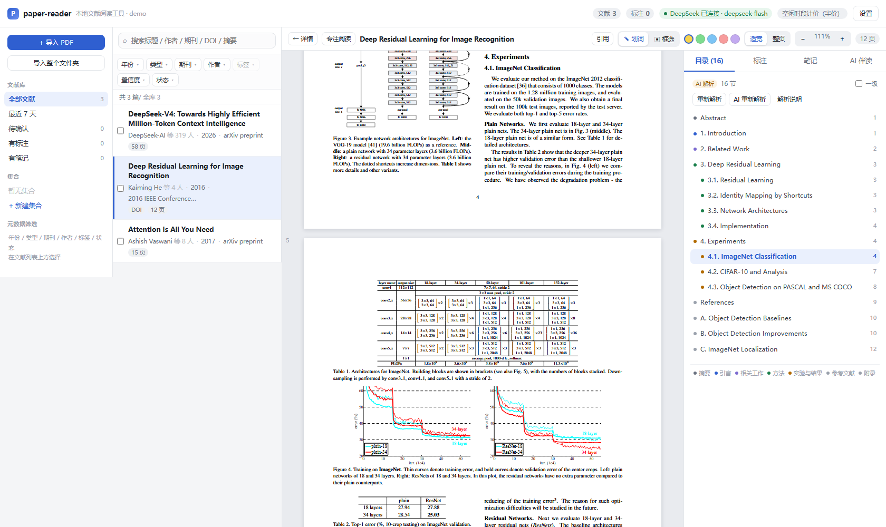
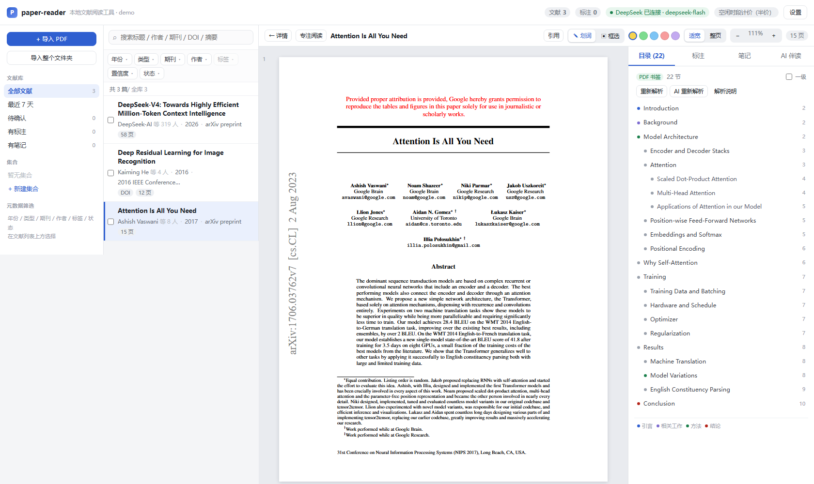
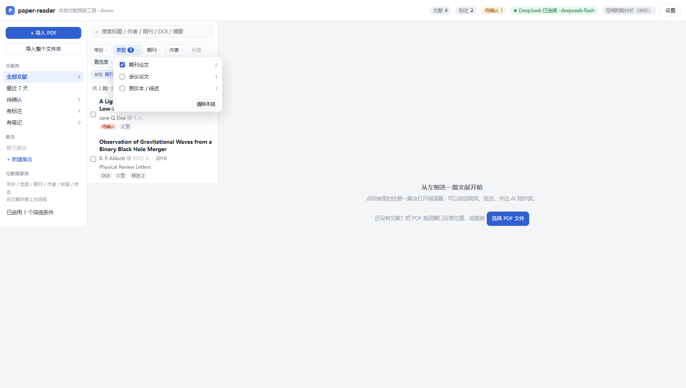
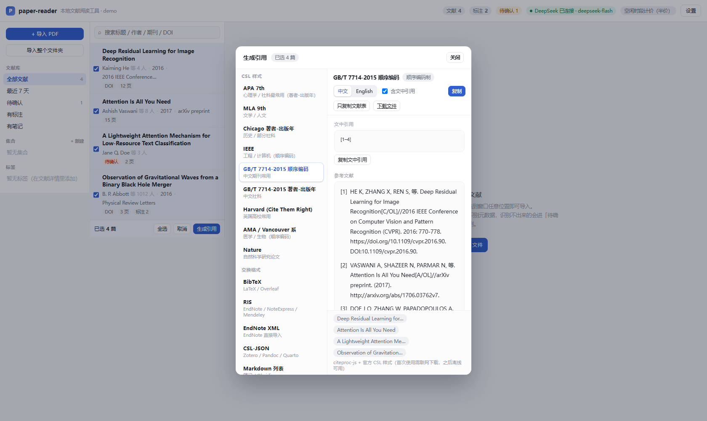

# paper-reader · 本地 Web demo

自制 Zotero 类工具的本地 Web 版：**PDF 导入 + 元数据自动识别 + 文献管理 + 标注 + 结构解析 + 多格式引用 + DeepSeek AI 伴读**。
纯本地运行，数据全部存在你自己的机器上（`data/`）。

对应设计文档：[docs/spec-v1.md](docs/spec-v1.md)（功能规格）、[docs/brainstorm-01.md](docs/brainstorm-01.md)（路线与取舍）。

---

## 界面

| | |
|---|---|
|  |  |
| 阅读器：目录跳转、划词高亮、AI 伴读 | 结构解析：书签 / 版面 / AI 三层降级 |
|  |  |
| 按年份 / 类型 / 期刊 / 作者 / 标签筛选 | GB/T 7714、APA、IEEE 等 9 种样式 |

> 更多截图（含 Chrome 内置 PDFium 的渲染基准图）在 [docs/images/](docs/images/)。

---

## 快速开始

```bash
npm install
npm run dev
# 打开 http://127.0.0.1:5273
```

> **Windows + PowerShell 注意**：如果 `npm run dev` 报「禁止运行脚本」，说明执行策略挡了 `npm.ps1`。
> 用 `npm.cmd run dev`，或改 `cmd /c npm run dev`。

一条命令同时起前端和 API（Vite 中间件挂载，无需第二个进程）。

**不想配 API Key 也能看**：默认进入「演示模式」，AI 面板会用本地原文检索生成模拟回答，导入/元数据/标注全部可用。
要接真实模型，右上角「设置」填 DeepSeek API Key（只写入本机 `data/config.json`）。

---

## 三个功能怎么用

### 1. 导入 PDF + 元数据识别 + 管理

- 拖拽 PDF 到窗口任意位置，或左侧「导入 PDF」/「导入整个文件夹」。
- 元数据按 **四级降级** 识别，导入面板会逐步显示每一步的判定依据：

  | 级别 | 来源 | 结果 |
  | --- | --- | --- |
  | L0 | PDF 内嵌元数据 / 字号启发式（标题通常是首页最大字号那几行） | 打底 |
  | L1 | 首页正则找 DOI → **CrossRef** `/works/{doi}` | 高置信 |
  | L2 | **DeepSeek JSON mode** 抽取字段 → 拿标题去 CrossRef 反查校验 | 中/高置信 |
  | L3 | arXiv 编号 → arXiv API | 高置信 |
  | L4 | 仅启发式 → 标记「待确认」，进队列不阻塞导入 | 低置信 |

- 识别不出来的会打上红色「待确认」角标，可在详情页手工编辑，或点「重新识别元数据」看每一步日志。
- 去重：文件 sha256 → DOI → 归一化标题。
- 搜索走 SQLite `LIKE`（demo 简化；生产换成 FTS5，中文需 bigram 分词）。范围：标题 / 作者 / 期刊 / DOI / 摘要。
- 详情页可直接编辑元数据、加标签、看 CSL-JSON（与 Zotero / EndNote 互操作的格式）。

**按元数据筛选**

文献列表上方有一排分面筛选器，可任意组合（组内 OR，组间 AND）：

| 分面 | 说明 |
| --- | --- |
| 年份 | 按发表年，倒序 |
| 类型 | 期刊论文 / 会议论文 / 预印本 / 学位论文…（CSL 类型映射成中文） |
| 期刊 | 期刊或会议名 |
| 作者 | 任意作者姓（库内可能上千人，下拉框带关键词搜索） |
| 标签 | 手动打的标签 |
| 置信度 | 高 / 中 / 低（元数据识别置信度） |
| 状态 | 待确认 / 已确认 / 有 PDF / 无 PDF / 有 DOI / 无 DOI / 有标注 / 有笔记 |

- 每个选项后面带**实时计数**；勾选后列表上方出现可单独移除的条件 chip，也有一键「清除全部」。
- 计数遵循标准 faceted search 语义：**只受搜索词、预设、集合影响，不受其它分面影响**，所以勾了一项不会让别的选项凭空消失。
- 列表顶部显示「共 N 篇 / 全库 M」，随时知道当前筛掉了多少。

**删除文献**

三个入口，都走同一个确认弹窗：

- 文献列表每行右侧的 `✕`（鼠标悬停出现）
- 勾选多篇后底部栏的「删除」（支持全选批量删）
- 详情页右下角「删除」

确认弹窗会先算清楚代价：多少篇、多少个 PDF 文件、多少条标注、多少条笔记、以及对应的 AI 对话记录，再让你确认。确认后：

- SQLite 里 `annotations` / `notes` / `chat_sessions` / `messages` 通过外键 `ON DELETE CASCADE` 一起清掉；
- 磁盘上的 PDF 文件同步删除（`data/pdfs/`）；
- 当前选中项、勾选状态、引用对话框里的选择会自动同步修正。

实测：导入一篇测试文献（含 1 条标注 + 1 条笔记）后删除 → `items 5→4`、`annotations 3→2`、`notes 1→0`、磁盘 PDF `5→4`。

### 2. 标注

- **划词即高亮**：选中文字 → 弹出颜色条，5 种颜色代表语义（重点 / 方法 / 结论 / 疑问 / 其他）；彩色圆点选色，也可点「AI 解释」「整理成笔记」。
- **框选图表/公式**：切到「▣ 框选」拖出矩形，会把区域裁剪成 PNG 一起存下来。
- 点击已有标注可改色、写批注、定位、删除。
- 坐标 **归一化到 0~1** 存储，缩放/重渲染不漂移；同时存原文，PDF 换了也能重新定位。
- 右侧「标注」页可按颜色筛选，点击跳回原页并闪烁高亮。

**阅读器的缩放**

- 默认 **适应宽度**：按 PDF 栏可用宽度自动算缩放，并随窗口大小实时重算，保证版面不会被裁掉。
- 「整页」按钮让一整页同时可见；`+` / `−` 进入手动缩放。
- 快捷键：`Ctrl/Cmd +`、`Ctrl/Cmd -`、`Ctrl/Cmd 0`（适应宽度）。
- 页面容器用 `width: max-content` + 居中，手动放大到超出屏幕时**左右两侧都能滚到**（直接给页面加 `margin:0 auto` 会产生"居中溢出"，左溢出永远滚不到）。
- 页面渲染任务在缩放变化时会 `cancel()` 上一帧，避免两次渲染写进同一块 canvas 出现重影。
- **DPR 只应用一次**：canvas 用 `devicePixelRatio` 放大位图，但坐标变换统一交给 pdf.js 的 `transform` 参数，代码里不要再额外 `ctx.setTransform(dpr,…)`。两边都设会让总缩放变成 `dpr²`，在 125%/150% 系统缩放的屏幕上内容被放大 1.25~1.5 倍、页面右缘整片被裁掉（dpr=1 时两次都是 1，所以只在高分屏上暴露）。

### 3. AI 伴读

- 右侧「AI 伴读」页围绕当前论文连续对话；回答里的 `[[p.N]]` 会渲染成可点击的 `p.N` 芯片，点了直接滚到那一页。
- **不做 RAG、不建向量库**：整篇论文全文作为固定前缀塞进 1M 上下文，比检索更准。
- prompt 结构刻意保持**字节稳定**，用来吃 DeepSeek 的[上下文硬盘缓存](https://api-docs.deepseek.com/zh-cn/guides/kv_cache)：

  ```
  system    : 固定不变的精读助手规则（要求标注页码、不许编造）
  user      : 【论文元数据】+【论文全文】<page 1>…</page>…   ← 永远不变
  assistant : 固定的通读确认语
  user      : 历史提问 1 … 历史回答 1 …                   ← 多轮累积
  user      : 新问题                                      ← 每轮只有这里是新的
  ```

- 底部成本条显示本次会话的输入/输出 token、**缓存命中率**、累计花费（按官方分时定价实时估算）。
- 划词/框选后点「AI 解释」或「整理成笔记」，会自动切到 AI 页并带上选中的原文与页码。
- 模型路由：`deepseek-flash`（默认，便宜、快、唯一支持视觉）／`deepseek-v4-pro`（更强推理，思考模式，不支持视觉）。

### 4. 论文结构解析与跳转

阅读器右侧第一个 tab 就是「目录」，解析出的章节可以点击直接跳到对应位置。

**分层解析，逐级降级：**

| 层级 | 来源 | 说明 |
| --- | --- | --- |
| L1 | **PDF 自带书签** | hyperref 生成的 PDF（arXiv 论文、会议模板）通常带完整目录树，最准，连层级都是对的 |
| L2 | **版面启发式** | 正文字号（取全篇出现最多的字号）+ 编号（`1.` / `3.1.` / `II.`）+ 章节关键词 + 首页题名区排除 + 跨页页眉页脚过滤 + 目录页识别 |
| L3 | **DeepSeek 语义解析** | 点「AI 重新解析」触发；读全文识别章节名与语义类型，再**把版面信息对齐回跳转位置**——语义来自 AI、坐标来自版面 |

- 跳转是**精确到行**的，不是只跳到页首：每节都记录 `yFrac`（标题在页面内自上而下的位置比例），点击后把标题滚到视口顶部约 16px 处。
- 滚动时会自动高亮当前所在章节。
- 每个章节带**语义类型**（摘要 / 引言 / 相关工作 / 方法 / 实验与结果 / 讨论 / 结论 / 参考文献 / 致谢 / 附录），列表左侧色点 + 底部图例区分，可以按类型快速扫读结构。
- 支持「只看一级标题」过滤，以及 `重新解析` / `AI 重新解析` 按钮。

实测：`Attention Is All You Need` 命中 22 条 PDF 书签；`Deep Residual Learning`（老 PDF 无书签）用启发式识别出 16 节，AI 解析后 16 节语义类型全部正确（method / results / appendix），耗时 2.8s、18132 tokens 输入。

> 副作用（正向）：为了做结构解析，正文抽取从「按 y 分行」升级成**按横向大间隙切分栏 + 按栏序重排**。这同时修掉了双栏论文里左右两栏文字被拼成一行的问题——之前喂给 AI 的全文是乱序的。

### 5. 多格式引用生成

入口有三处：详情页「生成引用」、阅读器工具栏「引用」、文献列表勾选多篇后的「生成引用」。

**CSL 样式**（citeproc-js + 官方 CSL 样式库，与 Zotero 同款引擎），支持 9 种：

| 样式 | 适用 |
| --- | --- |
| APA 7th | 心理学 / 社科（著者-出版年） |
| MLA 9th | 文学 / 人文 |
| Chicago 著者-出版年 | 历史 / 部分社科 |
| IEEE | 工程 / 计算机（顺序编码） |
| GB/T 7714-2015 顺序编码 | 中文期刊最常用 |
| GB/T 7714-2015 著者-出版年 | 中文社科 |
| Harvard (Cite Them Right) | 英国高校 |
| AMA / Vancouver 系 | 医学 / 生物（顺序编码） |
| Nature | 自然科学研究论文 |

每种样式同时给出 **文中引用** 与 **参考文献表**，可切换 中文 / English locale，支持多篇一次生成（顺序编码制会自动编号 `[1] [2] [3]`）。

**交换格式**（自行序列化，不依赖样式引擎）：BibTeX · RIS · EndNote XML · CSL-JSON · Markdown 列表 · LaTeX `thebibliography` · 纯文本引用串。

细节处理：
- CrossRef 的 `journal-article` / `proceedings-article` 不是合法 CSL 类型，会先归一化，否则 GB/T 会退化成 `[Z/OL]`、APA 会多出一个 "In"。
- 无 DOI 的 arXiv 预印本按 BibTeX 规范输出 `@misc` + `eprint` / `archivePrefix`，而不是硬塞 `@article`。
- BibTeX 键自动生成并去重（`abbott2016observation`、`vaswani2017attention`），页范围 `770-778` 自动转成 `770--778`，LaTeX 特殊字符自动转义。
- 样式与 locale 文件首次使用时从官方仓库下载并缓存到 `data/csl/`，之后完全离线；也可 `node scripts/warm-csl.mjs` 一次预热全部。

> CSL 样式来自 [citation-style-language/styles](https://github.com/citation-style-language/styles)，授权 CC-BY-SA 3.0；再分发时需保留署名。

---

## 目录结构

```
server/
  db.js         SQLite(node:sqlite 内置) schema、迁移、筛选/分面查询
  csl-types.js  CSL 类型归一化与中文名（db 与 cite 共用）
  pdftext.js    pdf.js 抽文本、分栏切分、阅读顺序、PDF 书签
  metadata.js   四级元数据识别流水线（CrossRef / arXiv / DeepSeek JSON）
  outline.js    论文结构解析（书签 / 版面启发式 / DeepSeek）
  deepseek.js   SSE 流式对话、JSON 抽取、缓存与成本统计
  cite.js       引用生成：citeproc-js + CSL 样式，以及 BibTeX/RIS/EndNote 等序列化
  api.js        所有 HTTP 接口 + 演示模式
  plugin.js     把 API 挂进 Vite dev server
src/
  components/OutlineTab.tsx   目录（层级 / 类型着色 / 当前章节高亮）
  components/FilterBar.tsx    分面筛选（下拉 + 计数 + 条件 chip）
  components/DeleteConfirm.tsx 删除确认
  components/Reader.tsx       pdf.js 渲染 + 文本层 + 自绘标注层 + 浮动菜单
  components/AiPanel.tsx      AI 伴读面板
  components/CiteDialog.tsx   多格式引用生成
  components/*Tab.tsx         标注 / 笔记
  outlineStore.ts             目录状态
scripts/
  make-test-pdf.mjs   生成测试 PDF（fixtures/）
  warm-csl.mjs        预热 CSL 样式与 locale 到 data/csl/
  e2e.mjs             真实浏览器里跑划词 + 框选，断言标注落库并自动清理
  shot.mjs            CDP 截图 + 抓控制台错误 + DOM 几何探测
```

`fixtures/` 里三个测试 PDF：`with-doi.pdf`（真实 DOI，验证 CrossRef 链路）、`no-doi.pdf`（验证启发式兜底）、`deleteme.pdf`（验证删除链路，可反复导入）。

**几个刻意的技术选择**

- 用 Node 22 内置的 `node:sqlite`（需 `--experimental-sqlite`），**零原生依赖** —— 避开 `better-sqlite3` 的跨平台重编译，Mac 上克隆下来就能跑。
- 标注层自绘而不用 pdf.js 自带的 Annotation Editor：数据必须是自己的，才能喂给 AI、跨文档检索、和笔记互链。
- 不引入 Python 侧车（MinerU/GROBID），扫描件与图表交给 `deepseek-flash` 的视觉能力，保持纯 JS 栈。

---

## 验证

```bash
npm run typecheck                      # tsc --noEmit
node scripts/make-test-pdf.mjs         # 生成 fixtures/*.pdf
node scripts/warm-csl.mjs              # 预热全部 CSL 样式（离线可用）
node scripts/e2e.mjs                   # 划词 + 框选的端到端断言（需 dev server 在跑）
node scripts/shot.mjs 'http://127.0.0.1:5273/?item=3' shots/reader.png 8000
```

> `shots/` 是脚本产出的临时截图目录，已在 `.gitignore` 里；要长期保留的图放到 `docs/images/`。

API 层也可以直接用 curl 验证：

```bash
curl -X POST localhost:5273/api/cite -H 'Content-Type: application/json' \
  -d '{"itemIds":[1,2],"format":"apa","locale":"en-US"}'
curl -o refs.bib 'localhost:5273/api/cite/export?ids=1,2,3,4&format=bibtex'
```

**渲染正确性怎么验**：当怀疑"页面显示不全"时，用 Chrome 自带的 PDFium 渲染同一页做基准，和 pdf.js 的渲染对比——两套完全独立的实现，谁错一目了然：

```bash
# 浏览器内置阅读器渲染第 1 页
chrome --headless=new --screenshot=pdfium.png \
  'http://127.0.0.1:5273/api/attachments/4/file#page=1&zoom=page-width'
```

再用列剖面量页面留白：页面右内边距应当是 ~11%（对应 PDF 里文字右边界 545pt / 页宽 612pt），如果是 0.5% 就说明内容被放大了。`docs/images/pdfium-p1.jpg` 留了一份基准图。

高分屏（系统缩放 125% / 150%）下的渲染必须单独验一遍：`SHOT_DPR` 环境变量可以指定 `deviceScaleFactor`：

```bash
SHOT_DPR=1.5 node scripts/e2e.mjs      # 标注链路在 150% 缩放下是否仍然对齐
```

`fixtures/with-doi.pdf` 里埋了真实 DOI（LIGO GW150914），用来验证 CrossRef 链路；`no-doi.pdf` 用来验证无 DOI 时的启发式兜底。

---

## Git 约定

```bash
git clone <repo> && cd paper-reader
npm install
npm run dev
```

- **换行统一 LF**：`.gitattributes` 里 `* text=auto eol=lf`，仓库级 `core.autocrlf=false`。
  Windows / macOS 混着改也不会出现「整个文件都变了」的 diff。
- **不入库**：`data/`（含 DeepSeek API Key 的 `config.json`、SQLite、上传的 PDF）、`dist/`、
  `node_modules/`、`shots/`（脚本产出的临时截图）、`docs/paper/`（自己的论文 PDF）、`tmp/`。
  要长期保留的截图放 `docs/images/`。
- **提交信息**：`type(scope): 摘要`，type 用 `feat / fix / docs / refactor / test / chore`。
- 改渲染相关代码后，除了 `npm run typecheck`，请再跑一次 `SHOT_DPR=1.5 node scripts/e2e.mjs`
  ——高分屏（125% / 150% 系统缩放）下的问题只在 dpr≠1 时暴露。

---

## 已知边界（v1 没做的）
- 扫描版 PDF：本地抽不出文本 → AI 面板会明确提示不可用（视觉转写留到下一版）。
- 框选区域目前只存图，还没有把图片送进视觉模型（Files API 只收图片、单文件 64 MiB，接口已按文档留好位置）。
- 引用**插入**还没做：目前是「生成 + 复制 / 下载 .bib / .ris / EndNote XML」，还没有 Word / LibreOffice 插件，也没有在 Word 里维护引文字段与自动重排。数据层已经按 CSL-JSON 存好，接 citeproc-js 的 `makeCitationCluster` 或做 docx 域代码写入都是顺路的事。
- 云同步、多人协作、移动端：不在 v1 范围。
- 搜索用 `LIKE` 而非 FTS5；文献量大时需要换。
- 引用样式依赖官方仓库首次下载；完全离线环境可提前跑 `node scripts/warm-csl.mjs`。

想从干净状态开始：删掉 `data/` 目录再重启即可（`data/pdfs` 是附件，`data/paper-reader.db` 是数据库）。
